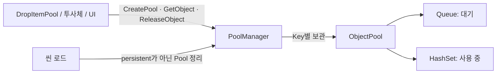

# BattleCloud

<본 프로젝트는 유로 에셋이 있어서 Scripts만 Pulbic으로 따로 올려놓았습니다>

Brotato와 Shape of Dreams를 래퍼런스로 한 자동 전투 기반 액션 로그라이크

---

## YoutubeLink

유튜브 링크[https://www.youtube.com/watch?si=68Xc2Xz6WCqP4tzr&v=C7CDYLtMGOw&feature=youtu.be]

## 📸 Screenshots 

---

## 게임 컨셉
플레이어는 외부와 격리된 제한된 공간에 고립되어,
해당 구역에서 발생하는 돌연변이 개체들의 침입을 막아야 하는 수호자 역할을 맡습니다.

돌연변이들은 공간 내부에서 지속적으로 발생하며,
이들이 구역을 돌파할 경우 다른 세계로 확산될 위험이 존재합니다.
플레이어는 이를 저지하기 위해 한정된 공간 안에서 웨이브 전투를 반복하며 생존해야 합니다.
전투는 자동으로 진행되며, 플레이어는 이동과 위치 조절을 통해 전투 흐름에 개입합니다.
각 전투 종료 후에는 정비 공간으로 이동해 무기와 아이템을 구매·강화하며 다가오는 돌연변이 웨이브에 대비합니다.
게임의 핵심은
- 제한된 공간에서의 생존과 위치 선택
- 돌연변이에 대응하는 빌드 설계
- 전투와 정비를 통해 점진적으로 강해지는 성장 구조
에 있으며, 반복 플레이를 통해 점차 더 높은 압박과 선택을 요구합니다.

---

## 핵심 특징
- 자동 전투 기반 액션 로그라이크
- Brotato 계열을 래퍼런스로 한 웨이브 전투 구조
- 전투 -> 정비 -> 전투로 이어지는 명확한 게임 루프
- 정비 공간 중심의 아이템 구매·강화·빌드 설계
- 조언자를 전투에 배치하고, 조언을 장착해 성장시키는 전투 구조
- 반복 플레이를 전제로 한 점진적 난이도 상승과 다양한 빌

---

## 게임 플레이 루프 
1. 전투 공간 진입
2. 재화 / 경험치 획득
3. 레벨업 보상 획득
4. 정비 공간 진입
5. 아이템 구매 / 강화 / 장착
6. 다음 전투 진입 / 반복

---

## 조작 방법
- 이동: WASD
- 상호작용 : 마우스 클릭 / 마우스 드래그

---

## 기술 스택
- Engine: Unity 2022.3.62f2 LTS  
- Language: C#  
- Platform: PC  

---

## 담당 코드 (본인 작성)

> 5인 팀 프로젝트입니다. 이 레포에는 팀 전체 스크립트가 들어 있으며, 아래 시스템은 본인이 설계·구현했습니다.

### 1. 오브젝트 풀 시스템

| 파일 | 역할 |
|---|---|
| [`ObjectPool.cs`](Scripts/00.Common/ObjectPool/ObjectPool.cs) | 대기 오브젝트(Queue)와 사용 중 오브젝트(HashSet)를 나눠 관리. 중복 반납 차단, 파괴된 오브젝트 건너뛰기 |
| [`PoolManager.cs`](Scripts/99.Manager/PoolManager.cs) | 문자열 Key로 Pool을 모아 관리. 씬 전환 시 유지할 Pool만 남기고 정리 |
| [`DropItemPool.cs`](Scripts/04.Item/DropItem/DropItemPool.cs) | 드롭 아이템 전용 Pool. 바닥 타일 위이면서 장애물과 겹치지 않는 위치 탐색 |

### 2. 데이터 파이프라인

| 파일 | 역할 |
|---|---|
| [`ExcelToJson.cs`](Scripts/97.Converter/Editor/ExcelToJson.cs) | 기획 엑셀의 모든 시트를 JSON으로 변환. ID 값 검증, 수식 셀은 계산 결과로 변환 |
| [`ExcelToJsonConverterWindow.cs`](Scripts/97.Converter/Editor/ExcelToJsonConverterWindow.cs) | 변환을 실행하는 에디터 창 (`Tools > Excel to JSON Converter`) |
| [`DataManager.cs`](Scripts/99.Manager/DataManager.cs) | JSON을 ID 기준 Dictionary, 티어별 List로 로드하고 `Get<T>(id)`로 조회 |
| [`SaveManager.cs`](Scripts/94.Save/SaveManager.cs) | Newtonsoft.Json으로 진행 상황 저장. 임시 파일 교체 방식 저장 + 백업 복구 |

## 리팩터링 기록

프로젝트를 마친 뒤 담당 코드를 다시 검토하며 고친 내용입니다.

| 시스템 | 문제 | 원인 | 개선 |
|---|---|---|---|
| 풀 | 같은 오브젝트가 두 곳에서 동시에 사용될 수 있음 | `Release()` 중복 호출 시 Queue에 두 번 들어감 | 사용 중 목록에 있을 때만 Queue에 반납 |
| 풀 | 씬을 다시 불러오면 드롭 아이템 Pool이 사라짐 | 씬 로드 시 인스펙터 `excludeKeys`에 없는 Pool을 모두 삭제 | `CreatePool(..., persistent: true)`로 Pool을 만드는 쪽이 유지 여부를 선언 |
| 데이터 | 엑셀 수식 셀이 `=A1*2` 같은 문자열로 저장됨 | 셀 타입이 Formula면 `ToString()` 사용 | 계산된 결과 타입(`CachedFormulaResultType`) 기준으로 값 변환 |
| 데이터 | 같은 JSON을 여러 번 파싱 (로드 시 44회) | 티어·키별로 나눌 때마다 파일을 다시 읽음 | 경로별 파싱 캐시로 **16회**(파일 수)로 감소 |
| 데이터 | 잘못된 데이터가 조용히 넘어감 | 중복 ID 덮어쓰기, 조건에 맞는 데이터가 없어도 확인하지 않음 | 로드 시 경고 추가 → 실제 데이터에서 중복 키·티어 불일치 발견 |
| 저장 | 저장 중 종료되면 세이브 파일 손상 | 기존 파일에 바로 덮어씀 | `.tmp`에 쓴 뒤 `File.Replace`로 교체, 직전 저장본 `.bak` 유지 |
| 저장 | 세이브 파일 `$type`으로 임의 타입 생성 가능 | `TypeNameHandling.Auto`만 사용 | `SerializationBinder`로 게임 어셈블리 타입만 허용 |
| 빌드 | 에디터 툴이 플레이어 빌드에 포함되어 컴파일 오류 | `UnityEditor`를 쓰는 변환 툴이 `Editor` 폴더 밖에 있음 | `97.Converter/Editor/`로 이동 |
